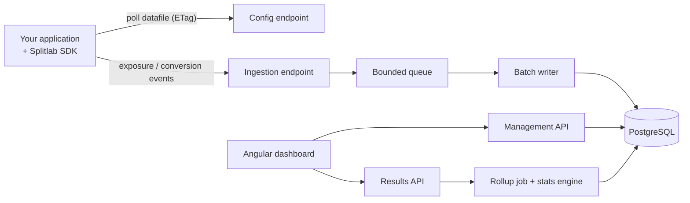

# Splitlab

Feature flags and A/B experimentation platform: a .NET 8 API, a decision SDK, an event pipeline, a statistics engine and an Angular dashboard.

Splitlab is a portfolio project that explores how experimentation platforms work: deterministic user bucketing, fast local SDK decisions, a resilient event pipeline and trustworthy results. Every significant design choice is recorded in [`docs/adr`](docs/adr/README.md).

## How it works



- **Decisions are local.** The SDK downloads a versioned datafile and assigns users itself, with no network call per decision ([ADR-0003](docs/adr/0003-deterministic-hash-bucketing.md), [ADR-0007](docs/adr/0007-sdk-datafile-polling-with-etag.md)).
- **Events are queued, then written in batches** and deduplicated by client event id ([ADR-0005](docs/adr/0005-event-ingestion-with-bounded-channel.md)).
- **Results are Bayesian**, with a sample ratio mismatch check that flags broken experiments ([ADR-0006](docs/adr/0006-bayesian-stats-with-srm-check.md)).

## Status

| Area | State |
| --- | --- |
| Decision SDK: hashing and bucketing | Done, tested |
| Decision SDK: datafile client, polling, decide API | Done, tested |
| Management API, persistence | In progress: projects, environments, experiments, audit log, datafile endpoint. Auth and flags still to do |
| Event ingestion pipeline | Planned |
| Statistics engine | Planned |
| Angular dashboard | Planned |
| Observability, load tests | Planned |

## Repository layout

```
src/Splitlab.Sdk/            Decision SDK (no server dependencies)
src/Splitlab.Domain/         Entities and business rules (no dependencies)
src/Splitlab.Application/    Use cases and repository interfaces
src/Splitlab.Infrastructure/ EF Core, PostgreSQL, migrations
src/Splitlab.Api/            HTTP endpoints and composition root
tests/                       SDK, domain and API integration tests
docs/adr/                   Architecture decision records
.github/workflows/          CI
```

## Getting started

Requires the [.NET 8 SDK](https://dotnet.microsoft.com/download/dotnet/8.0).

```bash
dotnet build
dotnet test
```

To run the API locally (migrations apply automatically in Development):

```bash
docker compose up -d
dotnet run --project src/Splitlab.Api
```

The management API lives under `/v1/projects/...` and the SDK polls `GET /v1/config/{environmentKey}`. It has no authentication yet ([ADR-0010](docs/adr/0010-authentication-and-tenant-isolation.md) is not implemented), so do not expose it.

## Bucketing in one example

```csharp
using Splitlab.Sdk.Bucketing;

var experiment = new Experiment(
    "checkout_flow",
    [new Variation("control", 5_000), new Variation("treatment", 5_000)]);

// Same user + same experiment => same answer, on any machine.
string? variation = Bucketer.Assign("user-42", experiment);
```

With a running API, `SplitlabClient` polls the datafile (ETag, jitter, exponential backoff) and decides locally; it keeps the last good snapshot on failure and returns your default plus a reason when it has nothing to go on ([ADR-0007](docs/adr/0007-sdk-datafile-polling-with-etag.md)):

```csharp
using var client = new SplitlabClient(
    new HttpDatafileSource(new HttpClient(), new Uri("https://splitlab.example/"), "production"));
client.Start();

Decision d = client.Decide("checkout_flow", "user-42", defaultVariation: "control");
// d.VariationKey, d.Reason (Assigned, NotInExperiment, ExperimentNotFound, ConfigNotLoaded)
```

`Assign` returns `null` when a user falls outside the experiment's allocated traffic. The hash input, bucket space and range layout are specified in [ADR-0003](docs/adr/0003-deterministic-hash-bucketing.md), and golden test vectors in `BucketerTests` let other language SDKs verify they agree.
